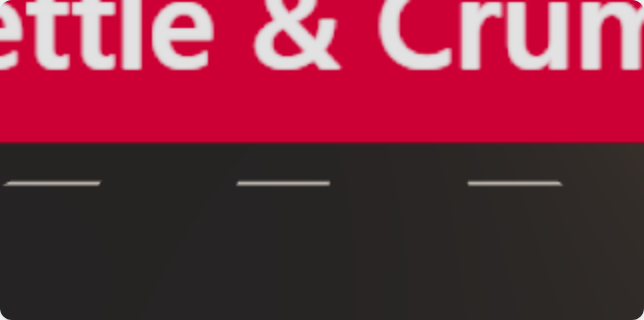
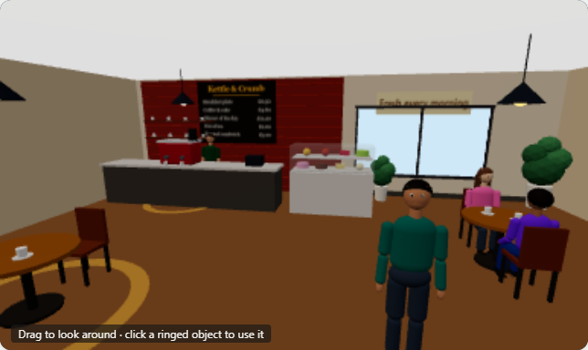

# Locations: what each place looks like and does

Every place the player can visit has its own environment that shows what it is,
built like the office: simple 3D shapes, lit for the hour, people at work or at
leisure, and objects to use. Nothing is a banner with a name on it.

Screenshots are in [screenshots/locations](screenshots/locations) and can be taken
again with `npm run shots:locations`.

## Before and after

Before, going into a place left the camera in the street pointing at the shop's sign:

Now each place has an interior of its own:

## The places

Objects with an amber ring on the floor can be used: click one to do what it says
(hovering shows what it costs and how long it takes, or why it cannot be done now).
Each does exactly what the matching button in the list does, with the same effects
on needs, energy, stress, money and time; nothing is decorative and clickable. The
player stands where they last did something.

| Place                           | What is there                                                                                                                                                                                                                                                        | Used by clicking                                                                                                                                     | Sound                                                     |
| ------------------------------- | -------------------------------------------------------------------------------------------------------------------------------------------------------------------------------------------------------------------------------------------------------------------- | ---------------------------------------------------------------------------------------------------------------------------------------------------- | --------------------------------------------------------- |
| **Kettle & Crumb** (café)       | Brick wall, menu board with today's prices, counter with espresso machine and barista, cake and pastry case, tables, customers, lamps, plants, windows                                                                                                               | Espresso machine: coffee and cake. Cake case: breakfast. A free table: dinner                                                                        | Coffee machine, cups, the till, conversation              |
| **Daily Basket** (food shop)    | Aisles of products with signs, lit chilled cabinets, fruit and veg, baskets and trolleys, checkout and cashier, shoppers                                                                                                                                             | Trolleys: a week of groceries. Chilled cabinets: a ready meal                                                                                        | Air conditioning, the till, trolleys, footsteps           |
| **Forge Fitness** (gym)         | Treadmills and bikes with members, dumbbell rack, benches, mirror wall, class studio with mats, reception, lockers, water station                                                                                                                                    | Weights: a workout. Studio: a class. Changing-room door: a shower                                                                                    | Treadmills, weights, footsteps, conversation              |
| **Millpond Park**               | Grass, a path round the pond, ducks, reeds, trees, flower beds, benches, lamp posts (lit in the evening), walkers and a jogger                                                                                                                                       | Pond-walk sign: a walk. Running-loop sign: a run. Bench: sit a while                                                                                 | Water, ducks, birds (crickets at night), wind             |
| **Cog & Kerb** (bikes and cars) | Showroom with cars, a bike rack, price board, booking counter, workshop corner, the open yard door                                                                                                                                                                   | Bike rack: buy (or sell back) a bike. Display car: lease (or hand back) a car                                                                        | Tools, an engine starting in the yard, the street outside |
| **Home**                        | The flat's rooms with their furniture, plus fittings that come with it: tall walls with windows, curtains, radiators and pictures, tiled kitchen and bathroom, a fridge and wall cupboards, toilet, basin and mirror, ceiling lights, the front door with coat hooks | Furniture you own: cook, coffee, takeaway, shower, bed, get dressed, call a friend, watch a series, games, study, read, yoga; the front door: go out | The fridge, a clock, traffic outside, birds or crickets   |
| **The office** (Cobalt Ridge)   | Unchanged: reception, desks and computers, the manager's office, break room, colleagues                                                                                                                                                                              | As before (people, the computer, the coffee machine…)                                                                                                | Typing, phones, the printer, chairs, conversation         |
| **The street**                  | Unchanged: the high street, homes, park and business district, traffic, passers-by                                                                                                                                                                                   | Doors                                                                                                                                                | Traffic, people, wind, birds; busier near the offices     |

## How it is built

- `src/city/scene/InteriorScene.tsx`: the 3D view inside a place. Only that place is
  loaded and drawn (each interior is its own small file in
  `src/city/scene/interiors/`); the street is not drawn while inside. The camera
  stands inside the room and can be turned and zoomed a little.
- `interiors/common.tsx` and `kit.ts`: rooms, windows, lamps, chairs, boards with
  painted signs and menus, and **hotspots**. The page gives the list of what can be
  done (the same list as the buttons), so the 3D view and the list always agree.
- Home: `src/home/scene/fittings.tsx` adds the fittings; furniture you own becomes a
  hotspot for what it is used for.
- Products on shelves are drawn in batches (one draw for hundreds of items).
- **Graphics** (Sound and graphics, in the top bar): Auto, High or Low for every 3D
  view. Low has fewer lights and people and a lower resolution; Auto chooses Low on
  computers that draw 3D without a graphics card.

## Adding a place

1. Add it to `PLACES` (and its actions to `PLACE_ACTIONS`) in `src/content/city.ts`.
2. Make `src/city/scene/interiors/<Place>.tsx`: a `Room`, the things that make it
   recognisable, a few people, and a `Hotspot` for each action.
3. Add it to `ROOMS` and `VIEWS` in `InteriorScene.tsx` and to `INTERIORS` in
   `CityView.tsx`.
4. Give it a scene in `src/audio/scenes.ts`.
5. Add it to `tests/e2e/interiors.spec.ts` and `tests/e2e/locations.spec.ts`.
